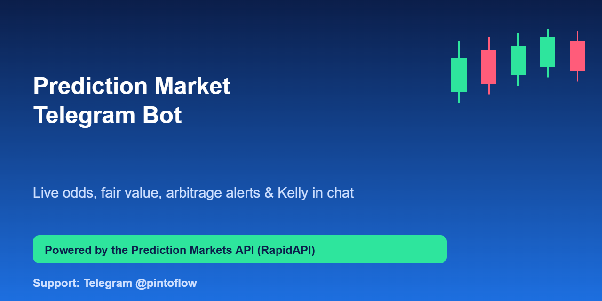
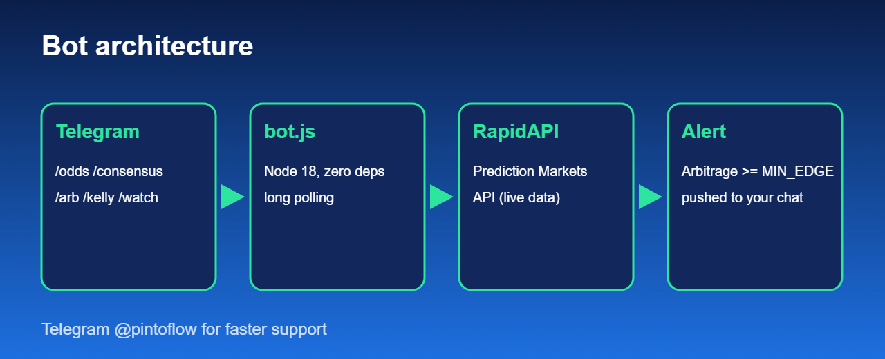

<p align="center"></p>

# Prediction Market Telegram Bot

Ask Telegram "what are the odds the Fed cuts?" and get Polymarket, Kalshi and Manifold numbers back, plus a volume-weighted fair value, arbitrage alerts and Kelly stake sizing. **Zero dependencies**, Node 18+, one file. Built on the [Prediction Markets API](https://rapidapi.com/belchiorarkad-FqvHs2EDOtP/api/prediction-markets).

> ⚡ Support and feature requests: Telegram **[@pintoflow](https://t.me/pintoflow)**



## Commands

| Command | Example | What you get |
|---|---|---|
| `/odds <topic>` | `/odds bitcoin` | Top matching markets with Yes/No probability and venue |
| `/consensus <topic>` | `/consensus fed rate cut` | Volume-weighted fair value and how much venues disagree |
| `/arb [topic]` | `/arb election` | Cross-venue arbitrage above `MIN_EDGE`, fee-aware |
| `/kelly p price [bankroll]` | `/kelly 0.6 0.45 500` | Half-Kelly stake from your own probability estimate |
| `/watch [topic]` / `/stop` | `/watch bitcoin` | Push alert whenever a new arbitrage appears |

## Setup

1. Create a bot with [@BotFather](https://t.me/BotFather) and copy the token.
2. Subscribe to the API (free plan available): https://rapidapi.com/belchiorarkad-FqvHs2EDOtP/api/prediction-markets
3. Run:

```bash
git clone https://github.com/BelNaruto/prediction-market-telegram-bot
cd prediction-market-telegram-bot
export TELEGRAM_TOKEN=... RAPIDAPI_KEY=... RAPIDAPI_HOST=...   # see .env.example
node bot.js
```

Host it anywhere that runs Node: a $5 VPS, Fly.io, Railway, or a Cloud Run job.

## How alerts work

`/watch` registers your chat. Every 90 seconds the bot calls `/api/arbitrage` with `minEdge` and `feeAware=true`, and messages you only about opportunities it has not already sent. Keep an eye on your RapidAPI quota: each watched chat costs about 960 calls/day, so use a topic filter and the Pro plan for heavy use.

## Ideas to extend

- Persist watchers in a file or Redis so they survive restarts
- Add `/history` that renders an OHLC chart image
- Group chat mode with per-topic subscriptions

## Disclaimer

Informational only, not financial advice. Not affiliated with Polymarket, Kalshi, Manifold or Telegram.

---
⚡ **Need help fast? Telegram [@pintoflow](https://t.me/pintoflow)** · API: [https://rapidapi.com/belchiorarkad-FqvHs2EDOtP/api/prediction-markets](https://rapidapi.com/belchiorarkad-FqvHs2EDOtP/api/prediction-markets) · MIT license
